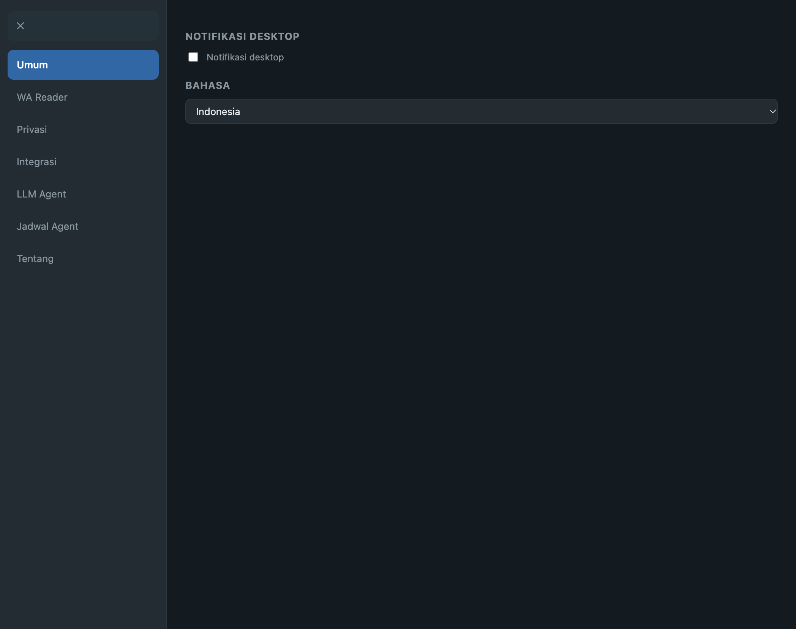
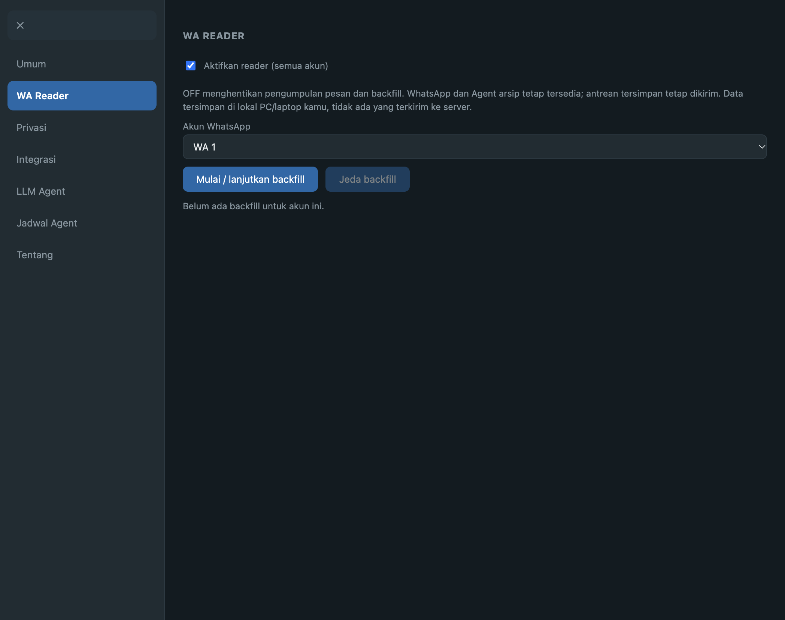
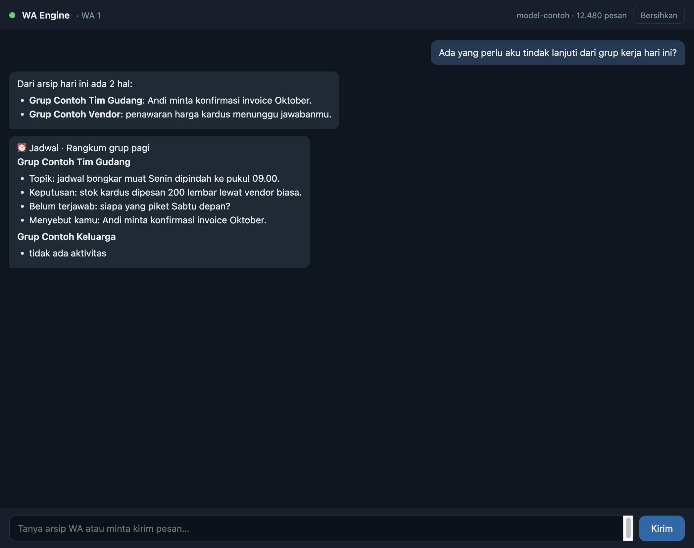
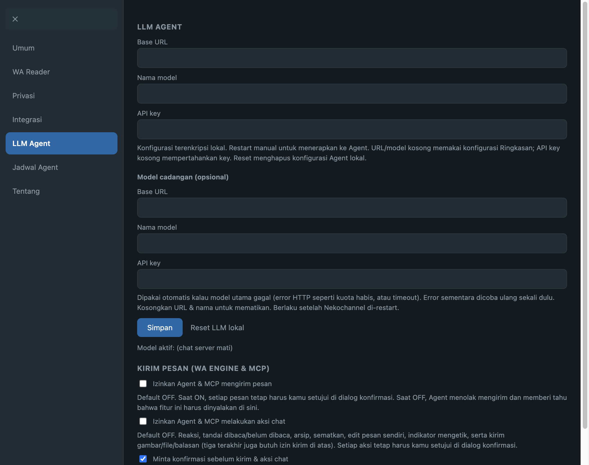
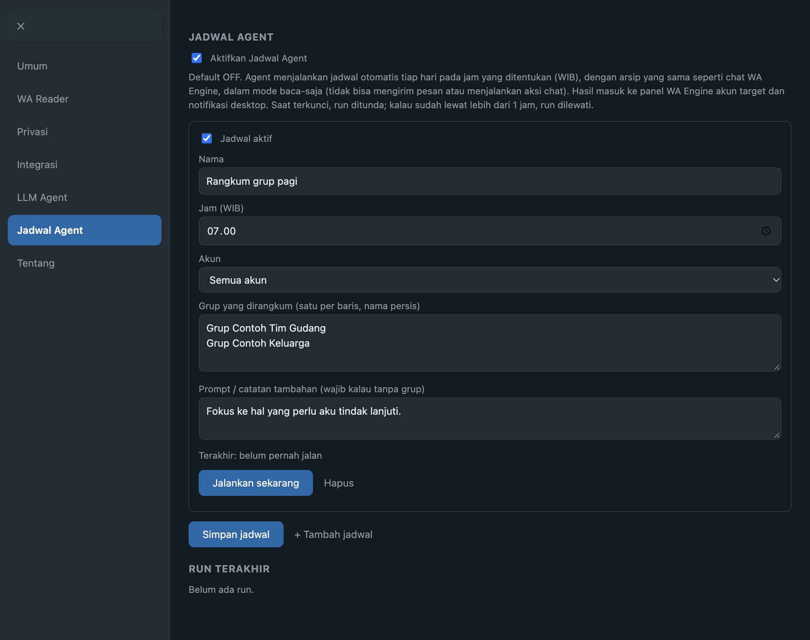
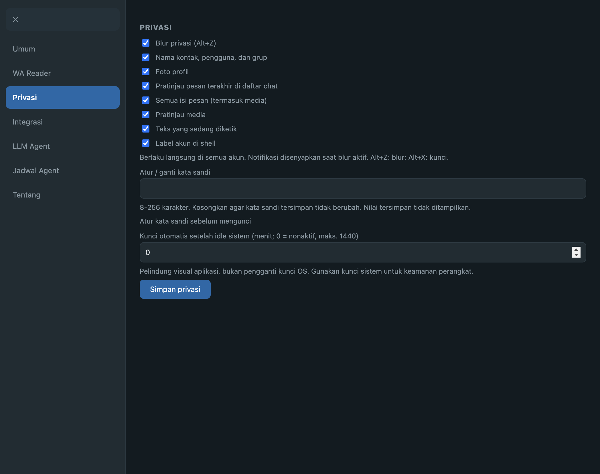
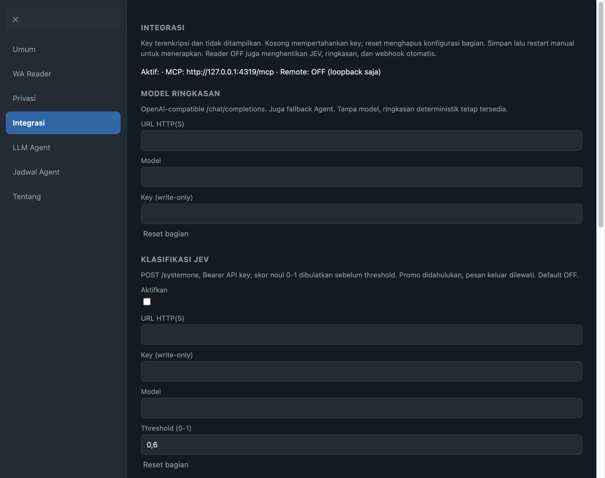

# Panduan Nekochannel

Nekochannel adalah aplikasi desktop untuk beberapa akun WhatsApp sekaligus. Pesan diarsipkan ke database lokal (SQLite), lalu bisa ditanya lewat asisten **WA Engine**, dirangkum terjadwal, dan diakses agent lain lewat **MCP**. Semua data tetap di komputer kamu.

> Screenshot di panduan ini diambil dari profil uji yang berisi data contoh, jadi tidak ada chat asli. Untuk membuat ulang: `node scripts/docs-shots.js` (hasilnya di `docs/img/`).

## 1. Mulai

```bash
npm install
```

```bash
npm start
```

1. Saat pertama dibuka, Nekochannel membuat satu akun WhatsApp. Scan QR-nya dari HP: **WhatsApp › Perangkat tertaut**.
2. Tambah akun lain dari sidebar. Klik kanan akun untuk ganti nama, ganti ikon, muat ulang, atau hapus.
3. Pintasan keyboard: **Ctrl+K** pindah akun cepat, **Ctrl+B** ciutkan sidebar.
4. Menutup jendela hanya menyembunyikan app. Untuk keluar sungguhan, pakai **Quit di tray**. Sebagian besar perubahan Settings (model, integrasi) baru berlaku setelah app di-restart.



## 2. WA Reader (arsip)

**Settings › WA Reader** mengatur pengambilan pesan ke arsip `wa.sqlite`, termasuk *backfill* riwayat per akun. Progresnya tampil langsung di halaman yang sama. Kalau Reader dimatikan, arsip tetap bisa dibaca, tapi pesan baru tidak masuk dan fitur otomatis seperti JEV, ringkasan, dan webhook ikut berhenti.



## 3. WA Engine — tanya arsip

Panel **WA Engine** (tab Agent, atau dock di kanan) adalah asisten chat di atas arsip. Contoh pertanyaan: "ada yang perlu aku tindak lanjuti dari grup kerja hari ini?", "rangkum chat sama Andi minggu ini", atau "siapa saja anggota grup Gudang?".



- **Satu sesi per akun.** Percakapan disimpan per akun dan dipulihkan otomatis setelah app di-restart.
- **Bersihkan** menghapus percakapan sesi aktif. Salinannya tetap disimpan sebagai backup.
- **Percakapan panjang diringkas otomatis.** Setelah lebih dari 16 pesan, pesan-pesan lama diringkas jadi satu blok rangkuman, sementara 8 pesan terakhir tetap utuh. Kalau peringkasan gagal, riwayat cukup dipotong seperti biasa, jadi chat tidak macet.
- **Info model** di pojok kanan atas menunjukkan model yang sedang melayani, termasuk kalau sedang memakai **model cadangan**.

## 4. Kirim pesan & aksi chat

Di **Settings › LLM Agent**, kirim pesan dan aksi chat dari Agent atau MCP **mati secara default**. Ada tiga saklar:

| Saklar | Default | Fungsi |
|---|---|---|
| Izinkan Agent & MCP mengirim pesan | OFF | `send_message`: kirim teks |
| Izinkan Agent & MCP melakukan aksi chat | OFF | `wa_action`: kirim gambar/file, balas, reaksi, tandai dibaca/belum, arsip/buka arsip, sematkan/lepas, edit pesan sendiri, indikator mengetik. Kirim gambar/file/balasan juga butuh saklar kirim. |
| Minta konfirmasi sebelum kirim & aksi chat | **ON** | Setiap kirim atau aksi muncul sebagai dialog **"Jalankan / Batal"**. Dialog yang tidak dijawab dalam **2 menit** dianggap batal. |

- **Dialog konfirmasi.** Klik **Jalankan** untuk menyetujui. Jangan tekan Enter, karena tombol default-nya adalah Batal.
- **Mematikan konfirmasi** sebaiknya hanya sementara, misalnya saat pengujian. Izin, rate limit (1 aksi per 30 detik per akun), dan catatan audit di `action-log.jsonl` (`confirm: "off"`) tetap berlaku.
- **Batasan:**
  - Reaksi hanya mendukung emoji di bar reaksi cepat WhatsApp (👍 ❤️ 😂 😮 😢 🙏).
  - Voice note belum didukung.
  - Status `ok` berarti aksinya sudah dijalankan di WhatsApp Web, tetapi belum memastikan pesannya sampai di server.



### Model utama & model cadangan

Isi **Base URL** (OpenAI-compatible, biasanya diakhiri `/v1`), **Nama model**, dan **API key**. Key bersifat write-only: setelah disimpan, isinya tidak pernah ditampilkan lagi.

**Model cadangan** opsional, dan dipakai otomatis kalau model utama gagal:
- Error sementara (jaringan, 429, 5xx) dicoba ulang sekali dulu di model utama.
- Error seperti kuota habis (401/403) atau timeout langsung pindah ke cadangan.
- Kalau keduanya gagal, chat menampilkan pesan "Primary and fallback models failed".

## 5. Jadwal Agent — rangkum grup otomatis

**Settings › Jadwal Agent** menjalankan agent setiap hari pada jam tertentu (WIB). Fitur ini **mati secara default**.



1. Centang **Aktifkan Jadwal Agent**.
2. Klik **+ Tambah jadwal**, lalu isi:
   - **Nama**
   - **Jam (WIB)**
   - **Akun**: menentukan sesi WA Engine yang menerima hasilnya.
   - **Grup yang dirangkum**: satu nama grup per baris, ditulis persis.
   - **Prompt / catatan tambahan** (opsional). Kalau tidak ada grup, prompt wajib diisi.
3. Klik **Simpan jadwal**. Tombol **Jalankan sekarang** berguna untuk mencoba tanpa menunggu jamnya.

Cara kerjanya:
- **Rentang pesan.** Rangkuman mencakup pesan sejak run sukses terakhir (pertama kali: 24 jam, maksimal 7 hari). Isinya per grup: topik, keputusan, pertanyaan yang belum terjawab, dan pesan yang menyebut kamu. Grup yang sepi ditulis "tidak ada aktivitas".
- **Lokasi hasil.** Hasil masuk ke panel WA Engine akun target dan bisa ditanya lanjut. Notifikasi desktop juga muncul; kalau blur privasi aktif, isi notifikasi disembunyikan.
- **Baca-saja untuk Agent.** Agent di dalam jadwal tidak bisa mengirim pesan atau menjalankan aksi chat.
- **Kirim hasil ke chat diri sendiri (opsional).** Centang **"Kirim hasil ke chat WhatsApp diri sendiri (You)"** dan pilih akunnya. Hasil terkirim otomatis, tanpa dialog konfirmasi, ke chat "(You)" milik akun itu sendiri (misalnya "+62 822-1953-3061 (You)"). Penerima dikunci ke nomor akun tersebut, jadi Agent tidak bisa mengubahnya. Karena pesannya ikut terarsip, rangkuman lama tetap bisa dibuka di WhatsApp maupun lewat WA Engine.
- **Saat app terkunci,** run ditunda. Kalau baru dibuka lebih dari 1 jam setelah jadwal, run dilewati (tercatat *terlewat*) tanpa menumpuk antrean.
- **Riwayat run** tampil di bagian **Run terakhir**. Log `schedule-log.jsonl` tidak menyimpan isi pesan.

## 6. Privasi

**Settings › Privasi** mengatur blur untuk nama, foto, pratinjau, pesan, media, kolom ketik, dan label akun. Di halaman ini juga ada **kunci app** dengan password dan kunci otomatis saat idle. Pintasan: **Alt+Z** untuk blur, **Alt+X** untuk mengunci (password harus diatur dulu). Blur juga bisa diatur dari tray. Saat blur aktif, notifikasi pesan disenyapkan.



## 7. Integrasi & MCP

**Settings › Integrasi** berisi model ringkasan, klasifikasi JEV, webhook, Sentry, dan **MCP arsip**. Semua key disimpan terenkripsi. Setelah mengubah apa pun di sini, simpan lalu restart app.



**MCP** (`http://127.0.0.1:4319/mcp`, JSON-RPC) memberi agent lain akses ke tool arsip. Setiap request wajib membawa header `Authorization: Bearer <key>`. Salin key lewat tombol yang disediakan, hanya saat diperlukan.

### Akses MCP dari mesin lain (Tailscale)

Centang **"Izinkan akses dari jaringan (Tailscale)"** (default OFF), simpan, lalu restart. Nekochannel menambah listener **khusus di IP Tailscale** mesin ini (rentang `100.64.0.0/10`); IP dan endpoint-nya tampil di bagian MCP. Aturannya:
- Hanya `POST /mcp`, dan Bearer key wajib.
- Maksimal 60 request per menit per IP; lewat dari itu dijawab 429.
- Setiap akses remote dicatat (waktu, IP, nama tool) tanpa isi.
- Kalau IP Tailscale tidak ditemukan atau bind gagal, status menampilkan **"Remote: gagal"**. MCP lokal tetap jalan.

Uji dari mesin lain di tailnet yang sama:

```bash
curl -H 'Authorization: Bearer <key>' -H 'content-type: application/json' -d '{"jsonrpc":"2.0","id":1,"method":"initialize"}' http://<ip-tailscale>:4319/mcp
```

## 8. Lokasi data

macOS: `~/Library/Application Support/Nekochannel/` (Linux/Windows: folder userData Electron).

| File | Isi |
|---|---|
| `data/wa.sqlite` | Arsip pesan, chat, anggota grup, dan sesi WA Engine (`chat_sessions`) |
| `settings.json` | Preferensi dan definisi jadwal (tanpa secret) |
| `integrations.enc` | Konfigurasi model, integrasi, dan key MCP (terenkripsi) |
| `action-log.jsonl` | Audit kirim dan aksi chat |
| `schedule-state.json`, `schedule-log.jsonl` | Status dan hasil terakhir jadwal; log run (tanpa isi) |
| `backup/` | Snapshot `settings.json` dan `accounts.json` |

## 9. Masalah umum

- **Agent tidak menjawab / "Configure an LLM".** Isi model di Settings › LLM Agent, lalu restart lewat tray.
- **Aksi/kirim "cancelled".** Dialog konfirmasi tidak diklik dalam 2 menit, atau yang diklik **Batal**.
- **Aksi "disabled".** Saklar kirim atau aksi masih OFF.
- **Jadwal "terlewat".** App terkunci atau mati lebih dari 1 jam setelah jam jadwal. Pakai **Jalankan sekarang** kalau perlu.
- **MCP remote "gagal".** Tailscale tidak aktif di mesin ini, atau port bentrok. Nyalakan Tailscale lalu restart.
- **Klik otomatis meleset di WhatsApp.** Zoom view WA (Cmd/Ctrl +/−) sudah ditangani otomatis. Kalau tetap meleset, muat ulang akun dari menu klik kanan.
